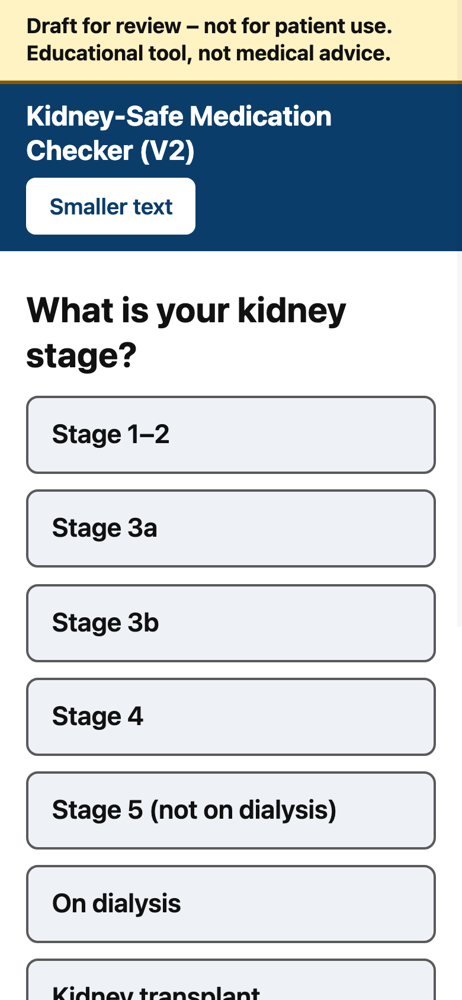
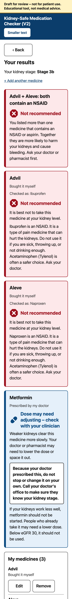
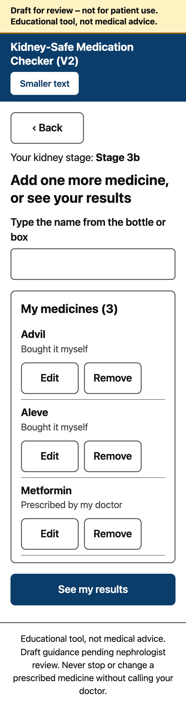
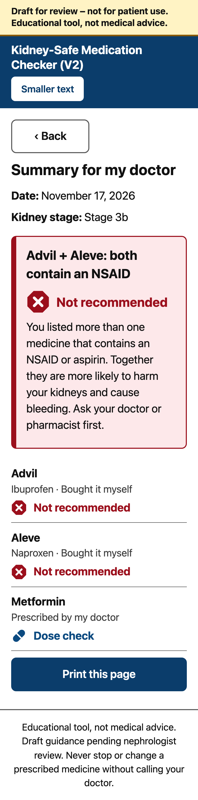

# Kidney-Safe Medication Checker

> **Draft for review – not for patient use. Educational tool, not medical advice.**
> Never stop or change a prescribed medicine without talking to your doctor.

**Live site:** https://avelarde2004.github.io/kidney-med-checker/
**Tests:** https://avelarde2004.github.io/kidney-med-checker/tests.html
**Results:** [results/](results/)

## What it does

A phone-friendly website that tells people with chronic kidney disease (CKD) whether a medicine they take needs a second look. The visitor:

1. picks their kidney stage (G1–2, G3a, G3b, G4, G5, dialysis, kidney transplant, or "I don't know"),
2. types the medicines they take, by generic or brand name (for example "Advil", "Aleve PM", "Bactrim"),
3. gets a plain-language result for each one:
   - **No change needed**
   - **Dose may need adjusting – check with your clinician**
   - **Consult your doctor**
   - **Not recommended**
   - **This cannot be assessed** (not enough information to give guidance)

   For a few medicines the answer depends on the exact eGFR number, so the site asks for it as a follow-up question. Visitors can also enter their eGFR instead of choosing a stage.

It also warns about combination products (cold and flu medicines, PM pain relievers and so on) and about taking two products with the same ingredient. A printout page summarizes everything for the patient's doctor.

The current table covers 46 medicine rules across 41 searchable medicines, plus 103 combination products.

**Who it's for:** patients with CKD and their caregivers, as a prompt to ask their care team about a medicine (not a replacement for that conversation). Also kidney clinics that want a simple handout link, which it isn't ready for yet (see *Before clinic use*).

## How to run it from a clean start

**Nothing needs to be installed for the site.** You only need `git`, Python 3 (built into macOS, and used here only as a simple local web server), and a web browser.

```
git clone https://github.com/avelarde2004/kidney-med-checker.git
cd kidney-med-checker
python3 -m http.server 8000
```

Then open:

- **http://localhost:8000** for the checker
- **http://localhost:8000/tests.html** for the automated tests. The page runs on its own and shows "All 136 tests passed…" at the top within a few seconds.

Stop the server with Control+C. You can't open the site by double-clicking `index.html`, because browsers block it from reading `data/table.json` that way. To try it on a phone on the same Wi-Fi, open `http://YOUR-COMPUTER-IP:8000` (on a Mac, find the IP with `ipconfig getifaddr en0`).

**The build scripts won't run from a clean clone, on purpose.** `scripts/build_data.py` rebuilds `data/table.json` from the nephrologist's review spreadsheet, and the label and evaluation scripts read the label-check spreadsheet. Those spreadsheets contain clinical reviewer notes, so they are kept out of the public repository. The finished `data/table.json` is included, so the site and tests run fully without them. `scripts/build_data.py` and `scripts/fetch_labels.py` are published so you can see how the table and label check were built.

### How the tests work

[`tests.html`](tests.html) has two parts:

1. **Medical rules (112 tests).** It checks the decision engine (`js/engine.js`) against the real table: expected results for each stage, combination products, double-up warnings, eGFR follow-up questions, search, and the exact wording patients see.
2. **The real site at phone width (24 tests).** It loads the actual website in a 360-pixel-wide frame and clicks through it like a patient would. It checks that buttons are big enough to tap (at least 48 px), that nothing scrolls sideways, and that results, editing, the saved list, the printout, and the disclaimer behave correctly.

The tests save and restore any medicine list stored in that browser, so running them won't erase your own list.

## Data and model

| Source | How it's used |
|---|---|
| **Nephrologist's medication lists** | The starting point: which medicines and products matter for CKD patients, and the stage cutoffs. |
| **FDA drug labels via [openFDA](https://open.fda.gov/apis/drug/label/)** | `scripts/fetch_labels.py` downloads the most recent label for each medicine (prescription or over-the-counter, to match the row) and pulls out every sentence that mentions the kidneys, word for word. Labels were pulled November 8, 2026. |
| **Claude (Anthropic), at build time only** | Drafted the first stage-by-stage table (v0) and the plain-language patient text. Compared each label's kidney sentences with the table and wrote a verdict with exact quotes. A script then confirmed every quote appears word for word in the label. Also helped write the website code and tests. |
| **Nephrologist sign-off** | Dr. Pramod reviewed every row, every label-check verdict, and every patient-facing text, and signed off on the final table (v2, November 13, 2026). |

**No AI runs while a patient uses the site.** The page is plain HTML, CSS and JavaScript. It looks answers up in the fixed, signed-off table, [`data/table.json`](data/table.json), so the same question always gets the same answer. There is no server code, account, cookie, analytics, or tracking. Nothing a visitor types is sent anywhere. If the visitor asks, the medicine list is kept in their own browser only.

**No secrets or patient information.** The repository contains no API keys or passwords; openFDA needs none for this volume. It contains no patient data: the table is general drug guidance, and the screenshots use example medicines.

| Path | What it is |
|---|---|
| `index.html`, `css/`, `js/` | The website. `js/engine.js` makes the medical decisions, `js/text.js` holds the screen wording, `js/app.js` draws the screens. |
| `data/table.json` | The signed-off table the site reads |
| `tests.html` | The automated tests |
| `results/` | Evaluation, label check, test results, screenshots |
| `scripts/build_data.py` | Builds `data/table.json` from the private review spreadsheet |
| `scripts/fetch_labels.py` | Downloads the openFDA labels for the label check |

**Kept private:** the review spreadsheets (line-by-line notes, comments, sign-offs, and the label-check worksheet), the raw label downloads, and the scripts that read those spreadsheets, including `scripts/evaluate.py`. They hold clinical reviewer notes that were never meant to be published. The public `data/table.json` contains only what patients see, plus the source of each rule.

## Results

- [**Evaluation summary**](results/evaluation_summary.md): how often the AI-drafted table matched the nephrologist's final answers, with and without the FDA label check, plus reading levels.
- [**Label check summary**](results/label_check_summary.md): 42 medicines compared with their FDA labels. 20 agree, 13 where the nephrologist's rule is stricter than the label, 4 where the label is silent, 3 with no label, and 2 where the label is stricter.
- [**Test results**](results/test_results.md): all 136 tests pass on the live site (112 rules, 24 on the real site).
- **Screenshots** of the live site at phone width (390 px):

| Stage screen | Results with a double-up alert | "My medicines" list | Printout for the doctor |
|---|---|---|---|
|  |  |  |  |

## Success criteria from the proposal

| Criterion | Status | Evidence |
|---|---|---|
| AI-drafted guidance agrees with the nephrologist's answer key in **≥ 90%** of drug-by-CKD-stage cases | **Not met** | The AI draft (v0) matched the final table in **200 of 250 cells (80.0%)**. Leaving out 3 vitamin rows whose scope changed during review gives 86.2%. The nephrologist changed 51 cells in 16 of the 42 rows, and 48 of those changes made the guidance *less* strict. The AI draft was too cautious more often than it was unsafe. ([evaluation](results/evaluation_summary.md)) |
| AI guidance **outperforms an AI given no label** | **Not met** | With the label check's concrete suggestions applied, agreement was **195 of 250 (78.0%)**, 2 points *lower* than without labels. Only 3 rows had a concrete suggested change. One of its 11 scored cell changes matched the final answer, and 6 moved a correct cell away from it. The label check was designed to verify and source the rules, not to redraft them; only 3 rows had a concrete suggested change, so this comparison is small. Its main value was catching unsupported claims (e.g., two FDA cutoffs the draft cited that are not in the labels) and giving every rule a traceable source. ([evaluation](results/evaluation_summary.md), [label check](results/label_check_summary.md)) |
| Patient text at or below **6th-grade** reading level | **Not met in full** | **97 of 108 (90%)** distinct patient texts score grade 6 or below (Flesch-Kincaid), with a median of grade 4.0. All result headlines and explanations, and both safety messages, are at or below grade 6. With drug names replaced by "this medicine", 105 of 108 (97%) are. Most texts above 6 are short alerts whose only long word is an ingredient name such as "acetaminophen". ([evaluation](results/evaluation_summary.md)) |
| Post-launch access metrics (QR code vs. visit notes, large-text use, drugs looked up) | **Not applicable yet** | The tool hasn't launched in a clinic, so **no metrics were collected**. What exists: the site reads a `?src=` tag from the link (for example `?src=handout` on a QR code) and holds it in the page, ready for future visit counting. It is not stored or sent anywhere. Large text is the default, with a "Smaller text" button. Nothing records which drugs were looked up, by design. |

## Limitations and next steps

### Where it fails or falls short

- **Accuracy target missed.** The AI draft matched the nephrologist 80% of the time, not 90%. Most misses were the AI being too cautious (for example "Not recommended" where the nephrologist said "Consult doctor" or "No change"). Every cell on the live site is the nephrologist's final answer, so these misses are in the draft, not on the site.
- **The label check didn't improve agreement.** FDA labels rarely give stage-specific advice (over-the-counter labels just say "ask a doctor if you have kidney disease"). They also use creatinine clearance rather than eGFR, and labels for the same drug differ between manufacturers.
- **Limited coverage.** Only the medicines and products in the table. Anything else shows "Not on our list yet. Ask your pharmacist or doctor."
- **Stage-based, not dose-based.** It uses kidney stage (and eGFR for a few medicines), not weight, age, other conditions, drug interactions, or the dose taken.
- **Reading level.** A few texts read above grade 6, mostly because of drug names.
- **No real-world use yet.** It hasn't been tested with patients, so usability and access metrics are unknown.
- **U.S. brands and labels only, English only.**

### What we didn't get to

- Usability testing with CKD patients and clinic staff.
- Collecting access metrics (QR code vs. visit notes, text size, lookups).
- Per-drug rows for SGLT2 inhibitors, whose label cutoffs differ.
- Spanish translation.

### What we'd do next

1. Finish the *Before clinic use* items below.
2. Run a small pilot in one clinic, with consent-based, anonymous counting of `?src=` visits and text-size use.
3. Re-run the openFDA label check on a schedule, so that label changes flag rows for the nephrologist to re-review.
4. Extend the table to the next most common medicines from clinic visit notes, with the same draft → label check → nephrologist sign-off process.

### Before clinic use

- For the AI Passport project (November 2026), Dr. Pramod approved all result-category texts. Before any clinic rollout, she should review in depth the result-category texts and any rows she approved in bulk rather than one by one.
- Descovy (M46) on dialysis is set to "Dose check": the label allows use on hemodialysis after each session, and peritoneal dialysis isn't covered. Confirm this with Dr. Pramod.
- Remove the "Draft for review" banner and the `noindex` tag only after these items are done and the clinic approves.

## Credits

Built by **Andrew Velarde**, with clinical review by **Dr. Pramod** (nephrology) and guidance from **Dr. Baslanti**.
**UF AI Passport Program, Group 4.**
